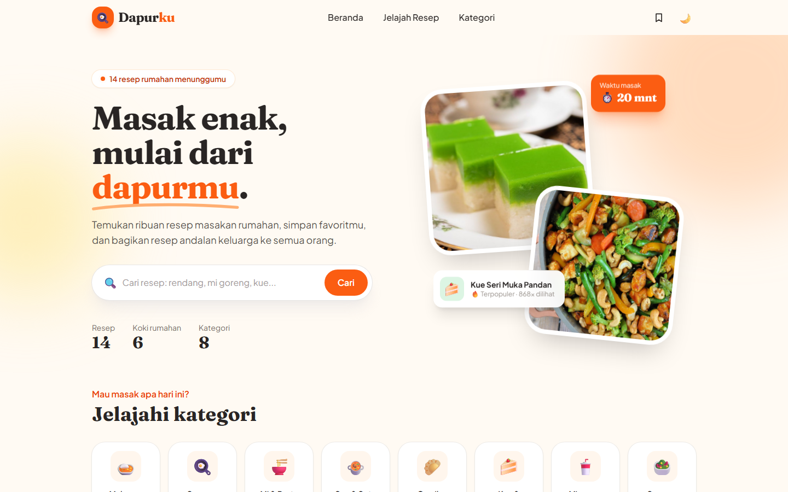
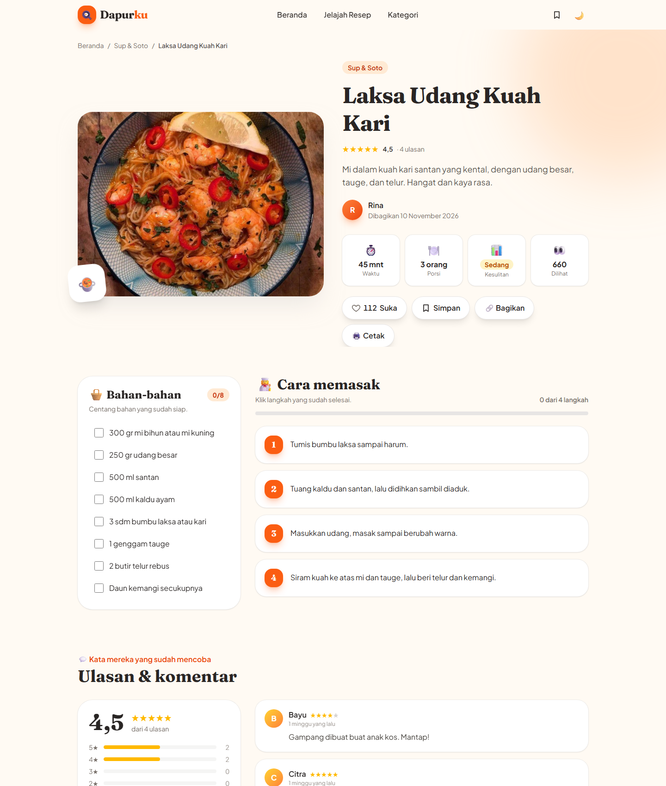
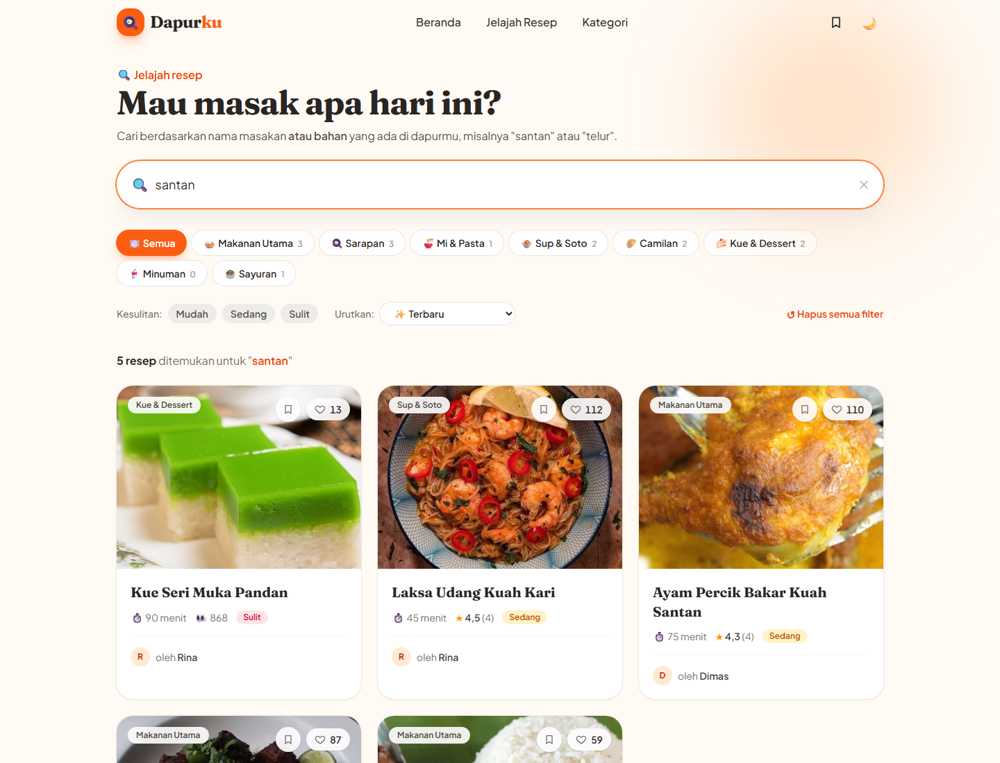
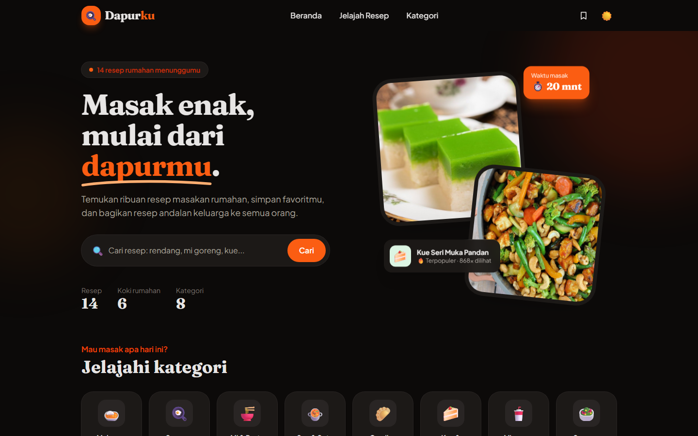
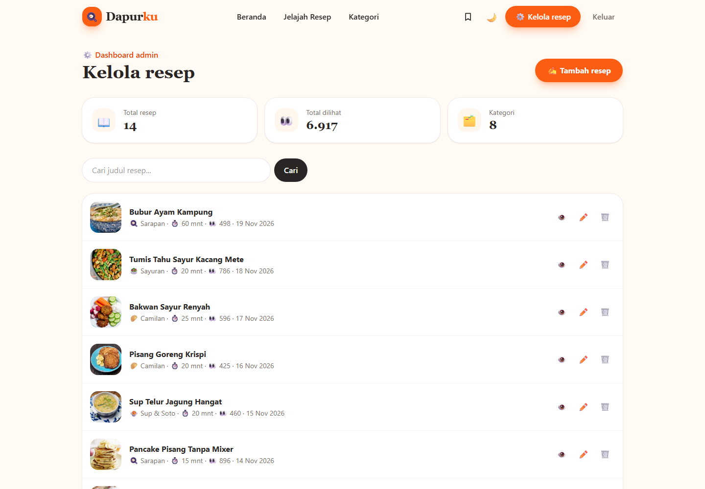
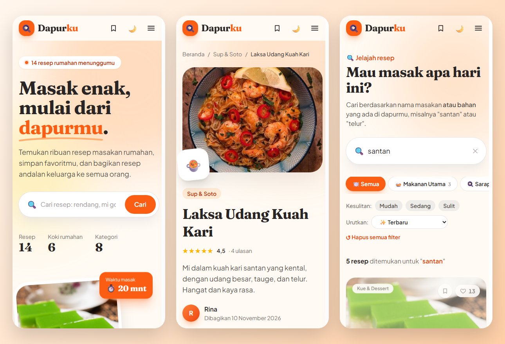

<div align="center">

# 🍳 Dapurku

**Website resep masakan rumahan: cari resep berdasarkan bahan yang ada di dapurmu.**

[](https://dapurku.wasmer.app)




</div>

## Tentang proyek

Dapurku adalah website resep yang dibuat dengan **Laravel**, **Livewire**, dan **Tailwind CSS**. Pengunjung bisa mencari resep, termasuk berdasarkan **bahan** yang mereka punya (misalnya "santan" atau "telur"), menyimpan resep favorit, dan memberi ulasan, semuanya **tanpa perlu membuat akun**. Pengelola mengatur resep lewat dashboard admin.

Proyek ini saya buat sebagai proyek portofolio untuk belajar membangun aplikasi web lengkap dengan Laravel: dari desain antarmuka, database, fitur interaktif, keamanan, testing, sampai deploy.

**🔗 Demo:** [dapurku.wasmer.app](https://dapurku.wasmer.app)

## Fitur

### Untuk pengunjung
- 🔍 **Pencarian langsung**: hasil berubah saat mengetik, tanpa reload. Mencari di judul, deskripsi, **dan daftar bahan**.
- 🗂️ **Filter dan urutan**: kategori, tingkat kesulitan, terbaru, terpopuler, rating tertinggi, tercepat dimasak.
- ♾️ **Infinite scroll**: resep berikutnya dimuat otomatis saat digulir.
- ✅ **Checklist bahan dan langkah memasak** dengan progress bar, tetap tersimpan walau halaman di-refresh.
- ❤️ **Suka**: jumlahnya tersimpan di database, dan satu sesi browser hanya bisa menambah satu suka per resep.
- 🔖 **Simpan ke Favoritku**: tersimpan di browser, tanpa akun.
- ⭐ **Ulasan dan rating bintang**: terkirim tanpa reload, lengkap dengan grafik sebaran bintang.
- 🖨️ **Cetak resep** dengan tata letak khusus kertas, dan 🔗 **bagikan** lewat menu bagikan bawaan HP.
- 🌙 **Mode gelap**, tampilan rapi di HP, dan animasi yang menghormati pengaturan "kurangi animasi".

### Untuk admin
- 🔐 Login khusus admin (tanpa halaman daftar publik), dibatasi 5 percobaan per menit.
- ✍️ Tambah, edit, dan hapus resep dengan **upload foto + pratinjau**.
- 🧺 Daftar bahan dan langkah yang bisa **ditambah, dihapus, dan diurutkan** langsung di form.
- 🗑️ Menghapus komentar yang tidak pantas.

## Tampilan

| Detail resep | Jelajah resep |
|:---:|:---:|
|  |  |
| **Mode gelap** | **Dashboard admin** |
|  |  |

<p align="center"></p>

## Teknologi

| Bagian | Teknologi |
|---|---|
| Backend | PHP 8.3, Laravel 13 |
| Interaksi tanpa reload | Livewire 4 (pencarian, filter, infinite scroll, komentar, Favoritku) |
| Interaksi kecil di browser | Alpine.js (menu, mode gelap, checklist, tombol suka dan simpan) |
| Tampilan | Tailwind CSS 4 dengan sistem desain sendiri (warna, font, animasi) |
| Database | MySQL |
| Testing | PHPUnit (35 test) |
| Hosting | Wasmer Edge |

## Hal teknis yang menarik

- **Pencarian berdasarkan bahan**: query dengan `orWhereHas('bahan', ...)`, jadi mengetik "santan" menemukan resep yang memakai santan walaupun tidak tertulis di judulnya.
- **Local scope** `Resep::untukKartu()`: satu tempat untuk eager loading penulis, kategori, rata-rata rating (`withAvg`), dan jumlah komentar (`withCount`), supaya tidak terjadi masalah N+1 query.
- **Slug otomatis** dari judul lewat model event `creating`, dan route model binding memakai slug (`/resep/rendang-daging-sapi`).
- **Fitur tanpa akun yang tetap jujur**: suka dicatat di session supaya tidak bisa ditambah berkali-kali, dan dibatasi dengan rate limiting. Komentar dibatasi 3 per menit per alamat IP.
- **Keamanan**: Gate `admin`, `is_admin` sengaja tidak bisa diisi lewat form (mass assignment), CSRF untuk request dari JavaScript, dan `DB::transaction` saat menyimpan resep beserta bahan dan langkahnya.
- **SEO dan pratinjau link**: meta description dan Open Graph per halaman, jadi link resep yang dibagikan ke WhatsApp tampil dengan foto dan deskripsinya.
- **Halaman error** (404, 403, 419, 429, 500) dengan desain yang konsisten.

## Menjalankan di komputer sendiri

**Yang dibutuhkan:** PHP 8.3+, Composer, Node.js, dan MySQL (misalnya lewat [Laragon](https://laragon.org)).

```bash
# 1. Ambil kode
git clone https://github.com/luluahb/dapurku.git
cd dapurku

# 2. Pasang dependensi
composer install
npm install

# 3. Siapkan pengaturan
cp .env.example .env
php artisan key:generate
```

Buat database MySQL bernama `dapurku`, lalu sesuaikan bagian database di `.env`:

```env
DB_CONNECTION=mysql
DB_DATABASE=dapurku
DB_USERNAME=root
DB_PASSWORD=
```

```bash
# 4. Buat tabel dan isi data contoh (14 resep, 8 kategori, akun admin)
php artisan migrate --seed

# 5. Sambungkan folder upload foto
php artisan storage:link

# 6. Susun CSS dan JavaScript, lalu jalankan
npm run build
php artisan serve
```

Buka `http://localhost:8000`. Untuk masuk sebagai admin, buka `/admin/login` dan pakai `ADMIN_EMAIL` serta `ADMIN_PASSWORD` dari file `.env`.

### Menjalankan test

```bash
php artisan test
```

Test memakai database SQLite sementara di memori, jadi data di MySQL tidak tersentuh.

## Struktur penting

```
app/
├── Http/Controllers/
│   ├── HalamanController.php        # Beranda
│   ├── ResepController.php          # Detail resep + tombol suka
│   └── Admin/                       # Login admin + CRUD resep
├── Livewire/
│   ├── Jelajah.php                  # Pencarian, filter, infinite scroll
│   ├── KomentarResep.php            # Ulasan & rating
│   └── Favoritku.php                # Resep yang disimpan
└── Models/                          # Resep, Kategori, Bahan, Langkah, Komentar, User
resources/
├── css/app.css                      # Sistem desain (warna, font, animasi)
├── js/app.js                        # Komponen Alpine: tombol suka & simpan
└── views/                           # Blade: layout, komponen, halaman
tests/Feature/                       # 35 test otomatis
```

## Kredit

Foto resep contoh berasal dari [TheMealDB](https://www.themealdb.com). Font: Plus Jakarta Sans dan Fraunces.

---

<div align="center">
Dibuat oleh <a href="https://github.com/luluahb">@luluahb</a> dengan ❤️ dan sedikit garam.
</div>
